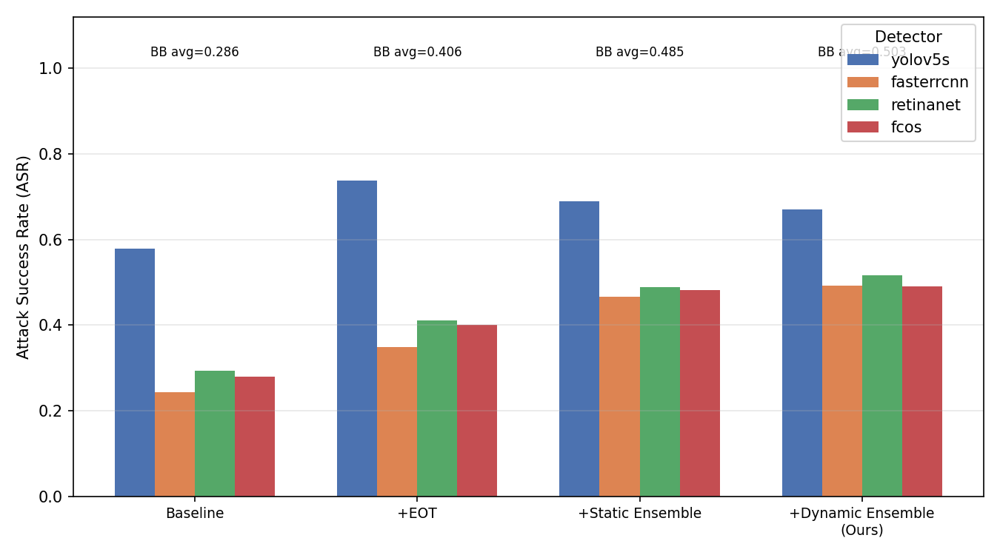
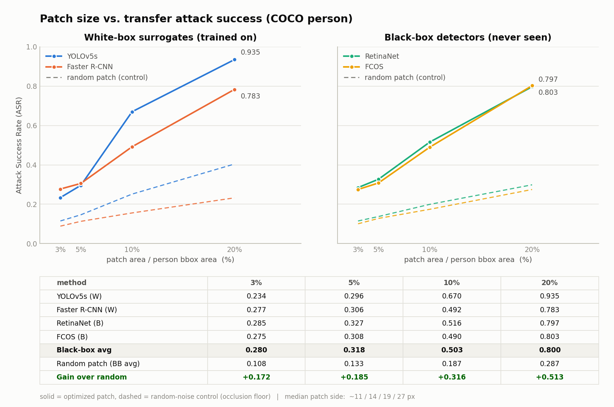
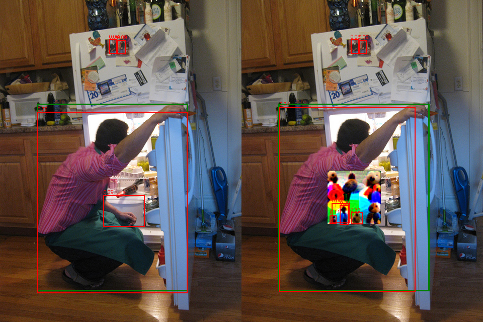
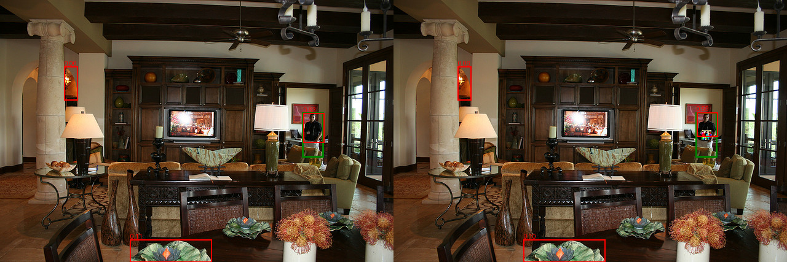
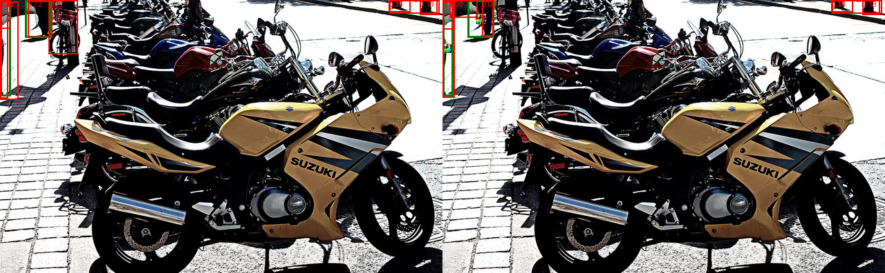
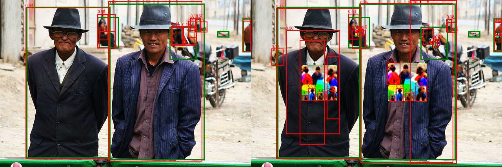

# 面向目标检测的可迁移通用对抗补丁（TUPatch）

实验报告 · 2026-10

---

## 0. 摘要

本工作研究**面向目标检测器的可迁移通用对抗补丁**：训练**一个固定尺寸的方形补丁**，把它贴到图像中所有 `person` 目标上，使目标从检测结果中消失（Object Vanishing）。

核心诉求是**可迁移性**——补丁只在 1–2 个白盒替代模型上训练，却要在**从未参与训练的检测器**上同样有效。最终方法在 2 个完全未见的检测器上取得**黑盒平均 ASR 0.503**（10% 补丁面积），最大档位（20%）达 **0.800**。

方法由三部分组成：**通用补丁 + EOT（期望变换）+ 动态重加权集成**。消融显示 EOT 是迁移性的主要来源（+0.119），动态加权的边际收益较小（+0.018）且尚未跑通多种子验证，是当前最薄弱的环节。

---

## 1. 问题

### 1.1 任务定义

给定一个在图像 $x$ 上被检测器正确检出的目标（本工作取 COCO 的 `person` 类），希望构造一个**与图像无关**的扰动补丁 $p$，使得把 $p$ 贴到该目标区域后，检测器**不再把它检出来**：

$$
D(\mathcal{T}(x, p)) \;\text{中不存在与 GT 目标匹配的 person 检测}
$$

其中 $\mathcal{T}$ 是贴图算子。补丁 $p$ 是**通用（universal）**的：对所有图像、所有该类的目标都用同一份 $p$。

### 1.2 威胁模型

| | 设定 |
|---|---|
| 攻击者掌握 | 替代检测器 $D_1..D_M$ 的**完整参数与梯度**（白盒） |
| 攻击者不掌握 | 目标检测器 $D_{bb}$ 的结构与参数，**也没有它的训练/查询权限** |
| 攻击形式 | 数字域补丁（不涉及物理打印与拍摄） |
| 目标 | 迁移攻击成功率最大化 |

关键约束：**补丁必须在替代模型上训练，在未见模型上评估**。因此参与训练的模型称**白盒（W）**，从未参与训练的称**黑盒（B）**，后者的 ASR 即迁移攻击成功率。

### 1.3 评价指标

$$
\mathrm{ASR} = \frac{\#\{\text{干净图上被正确检出、加补丁后不再被正确检出}\}}{\#\{\text{干净图上被正确检出的目标}\}}
$$

- **正确检出**：与 GT 的 $\mathrm{IoU} \ge 0.5$ 且置信度 $\ge 0.5$
- 分母刻意**不取全部 GT 目标**。若取全部 GT，检测器本来就漏检的目标会被算作"攻击成功"，使 ASR 虚高。分母按**每个检测器各自的 clean recall** 计算，因此不同检测器的 ASR 基数不同，这也解释了为什么必须同时报告 `clean_recall` 与 `n_clean_det`。

**黑盒平均（BB avg）**：固定在 `{RetinaNet, FCOS}` 两个**全程未参与训练**的模型上取平均，保证四行消融之间可比。

> ⚠️ `Faster R-CNN` 的角色会翻转：在 `Baseline` / `+EOT` 两行里它没参与训练（黑盒），在 `+Static/Dynamic Ensemble` 两行里它是替代模型（白盒）。因此它的数值**不能跨行比较**，BB avg 也就刻意把它排除在外。

### 1.4 难点

1. **迁移性**：单一模型的梯度含模型特异性，直接优化会过拟合到替代模型的决策边界。
2. **通用性**：补丁要同时适配**不同尺度的目标**——COCO 中 person 尺度差异极大（bbox 面积 25 分位 730 px²，75 分位 19850 px²，相差 27 倍）。
3. **不可感知性 vs 攻击性**：补丁越大越有效，也越显眼。

---

## 2. 方案

### 2.1 总体流程

```
COCO(person)
   │
   ├─→ 替代模型（白盒）: YOLOv5s + Faster R-CNN
   │
   └─→ 训练通用补丁  ┌── EOT 随机变换（旋转/缩放/亮度/对比度/位置）
                     ├── 动态重加权集成（谁难打谁权重大）
                     └── 置信度抑制损失 + TV 正则
   │
   └─→ 黑盒模型（从未训练）: RetinaNet + FCOS  →  迁移 ASR
```

### 2.2 补丁参数化与贴图

补丁是**一个**可学习的 $p \in [0,1]^{3 \times 64 \times 64}$ RGB 张量。

**关于尺寸的准确表述**：`patch_size=64` 是**可学习纹理的基础分辨率**，不是补丁的显示尺寸。实际贴图边长由目标框面积决定：

$$
\text{side} = \sqrt{\texttt{patch\_ratio} \times (w_{box} \cdot h_{box})}
$$

64×64 的纹理经仿射变换（`grid_sample`）重采样到 `side` 大小后贴到目标上。因此**同一份纹理可以直接应用到不同尺度的目标，无需为每个目标单独训练补丁**。

> 这**不等于尺度不变（scale invariance）**。纹理被放大/缩小时攻击效果会变——第 5.2 节的补丁大小消融正是在量化这一依赖：黑盒平均 ASR 随 `patch_ratio` 从 0.280（3%）单调升到 0.800（20%）。

用 `grid_sample` 而非硬贴图，是为了让**梯度能回传到补丁张量**；仿射矩阵中同时编码了 EOT 的旋转与缩放。

### 2.3 攻击损失

对每张图、每个 GT person $m$，在与它 $\mathrm{IoU} > 0.3$ 的所有 **person 类**预测中取**置信度最高者** $q_m$，最小化其均值：

$$
L_{\text{conf}} = \frac{1}{M}\sum_{m=1}^{M} \max_{j \in \Omega_m} \; s_j,
\qquad \Omega_m = \{\, j : \text{label}_j = \texttt{person},\ \mathrm{IoU}(b_j, b_m^{gt}) > 0.3 \,\}
$$

只压**置信度**，不攻击框的位置或类别——压低置信度直接等价于"漏检"。总损失附加 TV 正则抑制补丁内部高频噪点：

$$
L = L_{\text{conf}} + \lambda_{tv}\cdot \mathrm{TV}(p), \qquad \lambda_{tv} = 0.1
$$

### 2.4 EOT（Expectation Over Transformation）

每一步前向之前，对补丁施加一次**随机变换**再贴图，使补丁不依赖特定姿态/光照/位置：

| 变换 | 范围 |
|---|---|
| 旋转 | ±20° |
| 缩放 | 0.7 – 1.3 |
| 亮度 | ±0.3 |
| 对比度 | ±0.2 |
| 位置 | 在 bbox 内随机偏移（中心 ±25%） |

EOT 是**迁移性的主要来源**：消融中它单独贡献 +0.119，是三步中最大的一步。

### 2.5 动态重加权集成（Dynamic Reweighted Ensemble）

朴素多模型集成是等权平均，会被"已经攻下的模型"稀释梯度。本方法每一步重新分配权重给**当前最难打的模型**：

$$
h_m = \frac{S_m(t)}{S_m(0)},\qquad w_m = \mathrm{softmax}\!\left(\frac{h_m}{\tau}\right),\qquad \tau = 0.5
$$

- $S_m(t)$：第 $m$ 个替代模型**当前步**的损失（即 $L_{\text{conf}}$）
- $S_m(0)$：**初始步**的损失，用作归一化基准（消除模型间损失的尺度差异）
- 某模型被压得越低，$h_m$ 越小，权重越小；反之权重越大

两个实现细节：

1. **权重是 detach 的**。代码写作 `h[i] = l.detach() / (c0 + 1e-6)`，经运行时验证 `w.requires_grad=False`、`w.grad_fn=None`，且梯度对 $l$ 的系数恰为 $w$。**优化器无法通过操纵权重来"作弊"**，行为正确。
2. **$S_m(0)$ 的估计较弱**：只在第一个出现有效损失的 batch 上记录一次，是单批估计。若该批目标过少会产生偏置，是已知的可改进点。

### 2.6 优化设置

| 项 | 值 |
|---|---|
| 优化器 | Adam |
| 学习率 | 0.01 |
| epoch | 30 |
| batch size | 8（真实批，非梯度累积） |
| 梯度处理 | L1 归一化 |
| 动量 | **关闭**（见下） |

**关于动量**：早期版本包含梯度动量（MI-FGSM 形式），但实验显示为**负收益**——同轮次对照中 `+EOT+Momentum` 的黑盒平均 0.381，低于不加动量的 `+EOT` 0.406。因此后续所有配置统一关闭动量。

| 方法（ratio=10%，旧轮次） | YOLOv5s | Faster R-CNN | RetinaNet | FCOS | 黑盒平均 |
|---|---|---|---|---|---|
| + EOT（无动量） | 0.738 | 0.349 | 0.411 | 0.400 | **0.406** |
| + EOT + Momentum | 0.709 | 0.331 | 0.388 | 0.373 | **0.381** |

### 2.7 伪码

#### 算法 1：补丁训练主循环

```python
# 输入: 替代模型 D[1..M], 训练集 B, 配置 cfg
# 输出: 通用补丁 p

p      = Parameter(rand(3, 64, 64))          # 唯一的可学习变量
opt    = Adam([p], lr=0.01)
S_init = [None] * M                          # 各模型的初始损失 S_m(0)

for epoch in range(30):
    for images, boxes_list in DataLoader(B, batch_size=8):

        per_model = [None] * M
        for _ in range(num_eot):             # EOT 采样次数（本实验 = 1）
            adv = [apply_patch(img, p, box, cfg, random_transform=True)
                   for img, box in zip(images, boxes_list)]
            for m in 1..M:
                det  = D[m](adv)                         # 可微前向
                loss = L_conf(det, boxes_list, person=0, iou_thr=0.3)
                per_model[m] += loss

        per_model /= num_eot

        # --- 记录初始损失 S_m(0)（仅首次有效时）---
        for m in 1..M:
            if per_model[m] is not None and S_init[m] is None:
                S_init[m] = per_model[m].detach().item()

        # --- 动态权重（detach！优化器不能反控权重）---
        if dynamic_ensemble and all(S_init):
            h = [per_model[m].detach() / (S_init[m] + 1e-6) for m in 1..M]
            w = softmax(tensor(h) / tau)                  # tau = 0.5
        else:
            w = [1/M] * M                                 # 静态等权

        total = sum(w[m] * per_model[m] for m in 1..M if per_model[m] is not None)
        total += lambda_tv * TV(p)                        # lambda_tv = 0.1

        total.backward()
        g = p.grad / (p.grad.abs().sum() + 1e-8)          # L1 归一化
        p.grad = g                                        # 无动量
        opt.step()
        clamp_(p, 0, 1)
```

#### 算法 2：贴图（EOT + 尺度适配 + 可微）

```python
def apply_patch(img, p, box, cfg, random_transform):
    w, h = box.width, box.height
    side = sqrt(cfg.patch_ratio * w * h)          # ← 显示尺寸由目标框决定
    side = max(side, 4)

    if random_transform:                          # EOT
        angle    = U(-20, 20)                     # 度
        scale    = U(0.7, 1.3)
        bright   = U(-0.3, 0.3)
        contrast = U(-0.2, 0.2)
        cx, cy   = box.center + U(-0.25, 0.25) * (w, h)
    else:
        angle, scale, bright, contrast = 0, 1, 0, 0
        cx, cy = box.center

    side *= scale
    p_t = clamp(p * (1 + bright), 0, 1)                    # 对补丁本身可微
    p_t = clamp((p_t - 0.5) * (1 + contrast) + 0.5, 0, 1)

    theta = affine_matrix(cx, cy, side, angle, img.shape)  # 仿射矩阵
    patch_warped = grid_sample(p_t, theta)   # 64x64 → side x side，梯度可回传

    return composite(img, patch_warped, center=(cx, cy))   # 贴回原图
```

#### 算法 3：评估 ASR

```python
def evaluate(D, dataset, p, cfg):
    n_clean = n_killed = 0
    for img, gt_boxes in dataset:
        det_clean = D(img)                                     # NMS 后推理
        hits = match(det_clean, gt_boxes, iou_thr=0.5, conf_thr=0.5)
        n_clean += len(hits)                                   # ← 分母

        adv = apply_patch(img, p, gt_boxes, cfg, deterministic=True)
        det_adv = D(adv)
        for b in hits:                                         # ← 分子
            if not any(match_one(det_adv, b, iou_thr=0.5, conf_thr=0.5)):
                n_killed += 1

    return n_killed / n_clean if n_clean else 0.0
```

---

## 3. 实验环境

### 硬件

| 项 | 值 |
|---|---|
| GPU | NVIDIA A100 80GB PCIe（SXM/PCIe） |
| 驱动 | 535.309.01 |
| 系统 | Linux 5.15.0-187-generic |

### 软件

| 项 | 版本 |
|---|---|
| Python | 3.10.22 |
| conda 环境 | `adv` |
| PyTorch | **2.7.1+cu126** |
| torchvision | **0.22.1+cu126** |
| CUDA runtime | 12.6 |
| cuDNN | 9.5.1 |
| numpy / matplotlib | 2.2.6 / 3.10.9 |
| Pillow | 12.3.0 |

### ⚠️ 环境陷阱（复现必读）

**torch 2.7.1 必须配 torchvision 0.22.1。** 安装 `ultralytics` 会把 torchvision 静默升级到 0.29，导致运行时抛
`RuntimeError: operator torchvision::nms does not exist`。
如果误升级，执行：

```bash
pip install torchvision==0.22.1 --index-url https://download.pytorch.org/whl/cu126
```

### YOLOv5 的接入方式

**不使用 `pip install ultralytics` 包**，而是直接调用本地 clone 的官方仓库 `ultralytics/yolov5`：

- **训练路径**：临时把 `Detect` 头置为 training 模式，取原始 `[bs, na, ny, nx, 5+nc]` 特征，
  手动解码 `xy/wh/obj/cls`（`xy=(t*2+grid)*stride`，`wh=(t*2)²*anchor`），得到
  `conf = sigmoid(obj) × sigmoid(cls[person])`。这样**梯度才能回传到输入/补丁**。
- **评估路径**：走标准推理（letterbox → 前向 → NMS → 缩放回原图坐标）。
- 权重 `yolov5s.pt` 首次使用自动下载到仓库目录。

torchvision 的检测器（Faster R-CNN / RetinaNet / FCOS）原生可微，直接调用。
需要注意 torchvision 返回的是 **91 类的 1-based 标签**（person = 1），代码里用权重元数据的
`categories` 建立到 COCO 80 类 0-based 的映射表修正。

---

## 4. 数据集

### 来源与划分

使用 **COCO 2017**（官方 `train2017.zip` / `val2017.zip`）。只保留**含 person 实例**的图。

三个集合互不重叠：

| 集合 | 来源 | 数量 | 用途 |
|---|---|---|---|
| **train** | `train2017` 含 person 图，`entries[0:2000)` | 2000 | 训练补丁 |
| **val** | `train2017` 含 person 图，`entries[2000:2500)` | 500 | 开发期调参 |
| **test** | `val2017` 含 person 图，`[0:500)` | 500 | **final test，只在最后评估** |

实现要点：`entries` 顺序 = 标注 JSON 中 image **首次出现的顺序**（dict 保序），**全程不排序**，
保证切片可复现。磁盘上 `train2017` 恰好是 `entries[0:2500]` 的**连续前缀**，因此 train/val 两张切片
的文件都在本地，且与历史实验的 train 集合完全一致（历史结果不作废）。

子集选取方式是**按标注顺序取前缀**，不是随机采样——这是为了让历史结果保持有效，代价是抽样不完全随机。

### 数据特性：目标尺度差异极大

对 COCO `val2017` 全量标注中的非 crowd person 实例（10777 个）统计 bbox 面积：

| 统计量 | 面积 (px²) |
|---|---|
| 25 分位 | 730 |
| 中位数 | 3,757 |
| 均值 | 20,876 |
| 75 分位 | 19,850 |

**尺度跨度接近 27 倍**，这正是补丁必须做尺度适配（而非固定物理尺寸）的原因。
换算成补丁边长（`side = sqrt(ratio × 面积)`）：

| ratio | 边长 25 分位 | 中位 | 75 分位 | 均值 | 最大 |
|---|---|---|---|---|---|
| 3% | 4.7 px | 10.6 px | 24.4 px | 17.5 px | 106 px |
| 5% | 6.0 px | 13.7 px | 31.5 px | 22.6 px | 137 px |
| 10% | 8.5 px | 19.4 px | 44.6 px | 32.0 px | 193 px |
| 20% | 12.1 px | 27.4 px | 63.0 px | 45.2 px | 273 px |

注意 **20% 档有 24.5% 的样本补丁边长超过 64px**（纹理分辨率），属于上采样，该档数值可能受纹理分辨率限制而非方法上限。

### 各检测器的干净性能（500 张 test 图）

| 检测器 | clean recall | n_clean_det |
|---|---|---|
| YOLOv5s | 0.490 | 1091 |
| Faster R-CNN | 0.756 | 1681 |
| RetinaNet | 0.562 | 1251 |
| FCOS | 0.674 | 1499 |

---

## 5. 实验结果

### 5.1 主消融：方法的每一步贡献

| 方法 | 替代模型 | YOLOv5s | Faster R-CNN | RetinaNet | FCOS | 黑盒平均 |
|---|---|---|---|---|---|---|
| Baseline | YOLOv5s | 0.579 (W) | 0.244 (B) | 0.293 (B) | 0.280 (B) | **0.286** |
| + EOT | YOLOv5s | 0.738 (W) | 0.349 (B) | 0.411 (B) | 0.400 (B) | **0.406** |
| + Static Ensemble | YOLOv5s + FRCNN | 0.689 (W) | 0.467 (W) | 0.489 (B) | 0.481 (B) | **0.485** |
| **+ Dynamic Ensemble（Ours）** | YOLOv5s + FRCNN | 0.670 (W) | 0.492 (W) | **0.516** (B) | **0.490** (B) | **0.503** |

(W) = 白盒，参与训练；(B) = 黑盒，从未参与训练，其 ASR 即迁移攻击成功率。

**三步步进增量**：

| 步骤 | 回答的问题 | 黑盒平均增量 |
|---|---|---|
| Baseline → +EOT | EOT 有用吗？ | **+0.119** ← 最大 |
| +EOT → +Static Ensemble | 多模型训练能提升迁移吗？ | +0.079 |
| +Static → +Dynamic | 动态权重比静态平均好吗？ | **+0.018** ← 最小 |



**读数**：EOT 是迁移性的主要来源。动态加权的边际收益（+0.018）**尚未跑通多种子验证**，可能落在种子噪声内，是当前最薄弱的结论。

### 5.2 补丁大小 vs 攻击性 trade-off

固定 dynamic 方法，只改 `patch_ratio`：

| ratio | 中位边长 | YOLOv5s | Faster R-CNN | RetinaNet | FCOS | **黑盒平均** |
|---|---|---|---|---|---|---|
| 3% | ~11 px | 0.234 | 0.277 | 0.285 | 0.275 | **0.280** |
| 5% | ~14 px | 0.296 | 0.306 | 0.327 | 0.308 | **0.318** |
| 10% | ~19 px | 0.670 | 0.492 | 0.516 | 0.490 | **0.503** |
| 20% | ~27 px | 0.935 | 0.783 | 0.797 | 0.803 | **0.800** |



**非线性非常明显**：

- 3% → 5%：几乎无增益（+0.038）
- 5% → 10%：**断崖跃升 +0.185**
- 10% → 20%：**再跃升 +0.282**

补丁面积翻倍带来的收益远大于面积本身的增长，说明存在一个**最小有效扰动规模阈值**。

**10% 是性价比拐点**：黑盒平均 0.503，而补丁边长中位数只有 19 px（约人身边长的 5%）。

#### 白盒优势只在补丁够大时才出现

计算「白盒平均 − 黑盒平均」：

| ratio | 白盒平均 | 黑盒平均 | 差值 |
|---|---|---|---|
| 3% | 0.256 | 0.280 | **−0.024** ← 白盒反而更低 |
| 5% | 0.301 | 0.318 | −0.017 |
| 10% | 0.581 | 0.503 | +0.078 |
| 20% | 0.859 | 0.800 | +0.059 |

小补丁时**被攻击的模型（YOLOv5s）反而比没见过补丁的模型更抗打**——这不像"对抗优化"应有的样子，原因见 5.3。

### 5.3 随机噪声对照：区分「对抗优化」与「单纯遮挡」

往人身上糊一块方块本身就会压低置信度。为确定补丁的收益究竟来自优化还是遮挡，做了**随机噪声对照**：
不训练，直接贴同尺寸的随机噪声，3 个随机种子取平均。

| ratio | 优化补丁（黑盒平均） | 随机噪声（黑盒平均） | **增益** |
|---|---|---|---|
| 3% | 0.280 | 0.108 | **+0.172** |
| 5% | 0.318 | 0.133 | **+0.185** |
| 10% | 0.503 | 0.187 | **+0.316** |
| 20% | 0.800 | 0.287 | **+0.513** |

随机噪声逐模型明细：

| ratio | YOLOv5s | Faster R-CNN | RetinaNet | FCOS |
|---|---|---|---|---|
| 3% | 0.115 | 0.089 | 0.115 | 0.101 |
| 5% | 0.146 | 0.113 | 0.137 | 0.128 |
| 10% | 0.251 | 0.156 | 0.199 | 0.174 |
| 20% | 0.404 | 0.232 | 0.299 | 0.275 |

**结论**：

1. **小补丁是真实的对抗攻击，不是遮挡**。3% 档优化补丁 0.280 vs 随机噪声 0.108，是后者的 **2.6 倍**。
2. **随机噪声的 ASR 随面积近似线性增长**（0.108 → 0.133 → 0.187 → 0.287），这正是纯遮挡效应的特征；
   而**优化补丁是超线性的**，增益随面积扩大。两者形态不同，进一步支持"增益来自对抗优化"。
3. 一个刺眼的对比：**20% 的随机方块（0.287）≈ 3% 的优化补丁（0.280）**。

#### 用随机噪声当分母：谁被优化得最多

以各模型**自身的**随机噪声 ASR 为分母，计算"优化倍数"：

| 检测器 | 3% | 5% | 10% | 20% |
|---|---|---|---|---|
| YOLOv5s | 2.03× | 2.02× | 2.66× | 2.31× |
| **Faster R-CNN** | **3.13×** | **2.71×** | **3.16×** | **3.37×** |
| RetinaNet | 2.48× | 2.38× | 2.59× | 2.67× |
| FCOS | 2.73× | 2.41× | 2.81× | 2.92× |

**Faster R-CNN 的优化倍数在每一档都是最高，YOLOv5s 都是最低**。这与动态加权"谁难打谁权重大"的设定一致：
训练把梯度倾斜给了更难攻击的 FRCNN，代价是**被攻击的模型自己欠训练**。

这解释了 5.2 末尾那个反常现象——3% 档白盒 ASR（0.234）低于黑盒（0.280）。

### 5.4 定性结果

各方法学到的补丁（64×64 纹理）：

| Baseline | + EOT | + Static Ensemble | + Dynamic Ensemble |
|---|---|---|---|
|  |  |  |  |

干净图 vs 攻击后（Dynamic Ensemble，YOLOv5s 评估，红框 = 预测 person，绿框 = GT）：






### 5.5 训练成本（A100 80GB，2000 张训练图 × 30 epoch）

| 配置 | 替代模型数 | 耗时 |
|---|---|---|
| Baseline / +EOT / +Momentum | 1 | 2,644 – 2,872 s（≈ 45 min） |
| + Static / + Dynamic Ensemble | 2 | 5,205 – 6,095 s（≈ 1.5 h） |

---

## 6. 结论

1. **可行**：单一 64×64 补丁，在 2 个完全未见的检测器上达到黑盒平均 **ASR 0.503**（10% 面积），20% 面积下达 **0.800**。
2. **EOT 是迁移性的主要来源**（+0.119），显著大于多模型集成（+0.079）与动态加权（+0.018）。
3. **补丁收益确为对抗性**：远超同尺寸随机噪声（增益 +0.172 至 +0.513，且随面积扩大），非单纯遮挡。
4. **攻击性与补丁大小强非线性**，10% 面积为性价比拐点。
5. **动态加权存在副作用**：Faster R-CNN 的优化倍数（3.1–3.4×）系统性高于被攻击的 YOLOv5s（2.0–2.7×），提示权重倾斜导致白盒模型欠训练。

---

## 7. 局限与待办

| # | 问题 | 状态 |
|---|---|---|
| 1 | **动态加权的 +0.018 未做多种子验证**，可能落在噪声内 | 🔄 进行中（`run_seeds.py`，static/dynamic × 3 seeds） |
| 2 | **20% 档可能被 64px 纹理分辨率卡住**（24.5% 样本边长 > 64px） | ⏳ 待跑 `patch_size=128` 对照 |
| 3 | **`S_m(0)` 仅单批估计**，首批目标过少时归一化基准有偏 | ⏳ 可改为前若干步滑动平均 |
| 4 | **子集按标注顺序取前缀**，非随机采样 | 已知，为保历史结果一致 |
| 5 | 未评估**感知相似度**（LPIPS/SSIM），"不可感知性"只有补丁尺寸这一代理量 | ⏳ |
| 6 | 未做**跨数据集验证**（如 INRIA Person） | ⏳ |
| 7 | 仅数字域，未做**物理世界**（打印-拍摄）验证 | ⏳ |

---

## 8. 复现方式

```bash
conda activate adv
cd /home/nfs/u2023-zlb/ai_sec

# 0) 冒烟测试（无需 COCO 与真实模型）
python -m tupatch.main smoke

# 1) 主消融（4 组）
python run_ablation.py --coco_root data/coco \
    --epochs 30 --num_train 2000 --num_test 500 --out_dir outputs_ablation

# 2) 补丁大小消融（0.10 复用主消融的 dynamic 结果）
python run_patchsize.py --coco_root data/coco \
    --ratios 0.03 0.05 0.20 --epochs 30 --num_train 2000 --num_test 500

# 3) 随机噪声对照
python run_random_control.py --coco_root data/coco \
    --ratios 0.03 0.05 0.10 0.20 --num_test 500 --out_dir outputs_random

# 4) 多种子重复（static vs dynamic）
python run_seeds.py --coco_root data/coco --seeds 42 43 44 \
    --methods static dynamic --epochs 30 --out_dir outputs_seeds

# 5) 出图
python make_report.py            --coco_root data/coco --out_dir outputs_ablation
python make_patchsize_chart.py   --summary outputs_patchsize/summary.json
```

---

## 附录 A：本文件夹结构

```
report/
├── README.md                       ← 本文件（问题 / 方案 / 环境 / 数据 / 结果 / 伪码）
├── figures/
│   ├── fig_ablation_chart.png      主消融柱状图
│   ├── fig_patchsize_tradeoff.png  补丁大小 trade-off 曲线（含随机对照）
│   ├── patches/                    四个方法学到的 64×64 补丁
│   └── comparisons/                Dynamic Ensemble 的干净 vs 攻击对比图
└── results/
    ├── ablation_summary.json       主消融原始结果
    ├── patchsize_summary.json      补丁大小消融原始结果
    └── random_control_summary.json 随机噪声对照原始结果
```

## 附录 B：源码位置

| 文件 | 职责 |
|---|---|
| `tupatch/config.py` | 全部超参数（可 JSON 存取） |
| `tupatch/detectors.py` | 检测器统一接口 + torchvision / YOLOv5 封装（含可微 YOLO 解码） |
| `tupatch/dataset.py` | COCO person 数据集（手写 JSON 解析 + 预加载 + 切片） |
| `tupatch/patch.py` | 补丁参数化 + EOT 变换 + `grid_sample` 贴图 |
| `tupatch/losses.py` | $L_{\text{conf}}$ 抑制损失 + TV 正则 |
| `tupatch/attack.py` | 训练主循环（EOT + 动态重加权集成） |
| `tupatch/evaluate.py` | mAP50 / Recall / ASR |
| `tupatch/visualize.py` | 补丁图与对比图 |
| `run_ablation.py` | 主消融入口 |
| `run_patchsize.py` | 补丁大小消融入口 |
| `run_random_control.py` | 随机噪声对照入口 |
| `run_seeds.py` | 多种子重复实验入口 |
| `make_report.py` / `make_patchsize_chart.py` | 出图脚本 |
